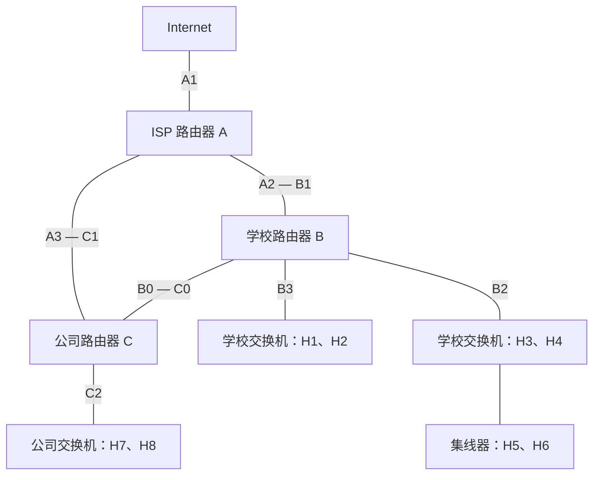

# 大题一：同一拓扑下的五类 IP 数据报转发

整理自 2026-10-18 提供的手写笔记。先做本题，再做[大题二：ARP 地址解析](02-arp-resolution.md)。本题把[模块 01 的分层与封装](../../01-cengdie/README.md)和[模块 03 的最长前缀匹配](../README.md)放进同一条发送路径中。

## 1. 题设与符号统一

学校路由器记为 B，公司路由器记为 C，ISP 路由器记为 A。保留笔记中的接口编号。讨论普通 IPv4 单播，假设配置正确、链路连通、TTL 足够，无 NAT、IP 分片和代理 ARP。各局域网内的交换机端口属于同一 VLAN。

为了填写逐跳 MAC 地址，下文把路由器间链路也按以太网处理；这是补充的教学条件。若题目指定 PPP 等链路，就应改用该链路的封装，不能强行填写以太网 MAC。



| 主机或接口 | IPv4 地址/前缀 | 所在网络或用途 |
|---|---|---|
| H1 | `166.1.0.1/17` | 学校低半区子网 |
| H2 | `166.1.14.2/17` | 学校低半区子网 |
| B3 | `166.1.0.5/17` | H1、H2 的默认网关，取自 ARP 页的标注 |
| H3 | `166.1.128.2/17` | 学校高半区子网 |
| H4 | `166.1.177.3/17` | 学校高半区子网 |
| H5 | `166.1.129.3/17` | 学校高半区子网，经集线器接入 |
| H6 | `166.1.150.1/17` | 学校高半区子网，经集线器接入 |
| B2 | `166.1.128.1/17` | H3～H6 的默认网关 |
| H7 | `200.1.1.2/24` | 公司局域网 |
| H8 | `200.1.1.3/24` | 公司局域网 |
| C2 | `IP_C2`，位于 `200.1.1.0/24` | 公司主机的默认网关；原图未给出具体 IP |

**抄录校准：**H7 的草图地址笔迹容易读成 `200.1.2.2`，但文字推导明确写 `200.1.1.2`，路由表也使用 `200.1.1.0`。本整理统一采用 `200.1.1.2/24`。若原题确实是 `200.1.2.2/24`，它不属于这里的公司子网，须先修正题设，不能照搬以下路径。

`MAC_H1`、`MAC_B3` 等表示主机网卡或**指定路由器接口**的 MAC；不能把整台路由器笼统写成一个 MAC。`IP_C0` 等未给出数值的路由器接口 IP 使用符号表示，不补造地址。

### 三张转发表

笔记中 ISP、公司表省略了掩码。这里将学校聚合网明确为 `/16`，公司网络明确为 `/24`；学校内部划分为两个 `/17`。所谓“传统网络”是题目的历史分类描述，做题时仍按明确前缀匹配。

| 路由器 | 目的前缀 | 出接口 | 该链路上的下一跳 |
|---|---|---|---|
| A（ISP） | `166.1.0.0/16` | A2 | B1 |
| A（ISP） | `200.1.1.0/24` | A3 | C1 |
| A（ISP） | `0.0.0.0/0` | A1 | 上游路由器 |
| B（学校） | `166.1.0.0/17` | B3 | 目的主机，直连 |
| B（学校） | `166.1.128.0/17` | B2 | 目的主机，直连 |
| B（学校） | `200.1.1.0/24` | B0 | C0 |
| B（学校） | `0.0.0.0/0` | B1 | A2 |
| C（公司） | `166.1.0.0/16` | C0 | B0 |
| C（公司） | `200.1.1.0/24` | C2 | 目的主机，直连 |
| C（公司） | `0.0.0.0/0` | C1 | A3 |

注意：B 与 C 有直接链路。因此学校和公司之间的报文按上述表走 B0—C0，不能仅因为图上有 ISP 就绕经 A。

## 2. 做题前先算网络号

`/17` 的掩码为 `255.255.128.0`。前两个字节固定，第三个字节的最高位也是网络位：

| 子网 | 第三个字节的范围 | 可用主机地址 | 定向广播地址 |
|---|---|---|---|
| `166.1.0.0/17` | 0～127 | `166.1.0.1`～`166.1.127.254` | `166.1.127.255` |
| `166.1.128.0/17` | 128～255 | `166.1.128.1`～`166.1.255.254` | `166.1.255.255` |
| `200.1.1.0/24` | 第三个字节固定为 1 | `200.1.1.1`～`200.1.1.254` | `200.1.1.255` |

单网卡主机只有直连路由和默认路由时，可以用下面的比较确定目的地址是否在本地子网：

```text
本机 IP & 本机掩码  ==  目的 IP & 本机掩码
```

例如 H1 的第三字节是 0，H3 的第三字节是 128：`0 & 128 = 0`，`128 & 128 = 128`，所以不同子网。H3 与 H6 则有 `128 & 128 = 128`、`150 & 128 = 128`，属于同一子网。

**主机使用自己的配置作判断；路由器则用每条候选路由各自的前缀长度匹配目的 IP。**不能拿源主机的 `/17` 替所有路由器查表。更一般的多网卡、静态主机路由场景也须先查主机自己的路由表。

## 3. 统一解题步骤

1. 写出源 IP、目的 IP，并判断目的是否为本机地址；发给自己通常由本机协议栈处理，不需要上网线查 ARP。
2. 源主机查路由：本题中，同子网直接交付目的主机，异子网交给默认网关。
3. 写出下一跳 IP。查本地 ARP 缓存，命中直接用；未命中才发 ARP 请求。
4. 封装以太网帧：源 MAC 是当前发送接口，目的 MAC 是当前链路上的下一跳。
5. 每台路由器解开输入链路封装，检查 IPv4 首部及本地交付条件，按目的 IP 作最长前缀匹配；转发时更新 TTL、首部校验和并重新封装。
6. 到达最终主机后，才把 IP 载荷交给相应上层协议。

这里的“查表”不是只看表的第一条，也不是看地址前几个字符。先找出所有匹配项，再选最长前缀；`/0` 总能匹配，但只在没有更具体的匹配时胜出。

## 4. 五个小问逐题分析

### ① H3 → H6：同一子网，经交换机和集线器

源 IP 为 `166.1.128.2`，目的 IP 为 `166.1.150.1`，两者与 `/17` 掩码相与均为 `166.1.128.0`。

- H3 直接查 `166.1.150.1 → MAC_H6`，不查默认网关。
- IP 数据报装入 `MAC_H3 → MAC_H6` 的以太网帧，经学校交换机、集线器到 H6。
- 普通二层交换机转发不改源/目的 MAC，也不递减 IP TTL。目的 MAC 已学到时走对应端口；未学到时在同一 VLAN 内向除入口以外的端口泛洪。
- 集线器不查 MAC 表，会把信号重复到其他端口。**H5 可能在物理上收到信号，但普通非混杂模式下，其网卡不把目的 MAC 为 H6 的单播帧作为自己的数据交给上层。**不能把这说成“H5 所在端口完全没有信号”。

本小问没有经过路由器，IP TTL 不因交换机或集线器而变化。

### ② H1 → H3：学校内部跨子网

H1 属于 `166.1.0.0/17`，H3 属于 `166.1.128.0/17`。

| 次序 | 操作 | 关键结果 |
|---|---|---|
| 1 | H1 判断目的不在本地子网 | 下一跳为默认网关 B3：`166.1.0.5` |
| 2 | H1 查 ARP，必要时请求 B3 的 MAC | 第一段帧为 `MAC_H1 → MAC_B3` |
| 3 | B 从 B3 收到帧后查目的 `166.1.128.2` | 命中 `166.1.128.0/17`，出接口 B2 |
| 4 | B 在 B2 所在子网解析 H3 的 MAC | 第二段帧为 `MAC_B2 → MAC_H3` |
| 5 | H3 收到数据报 | 源/目的 IP 仍为 H1/H3；TTL 比源主机发出时少 1（通常题设） |

这里有两次独立的邻居解析需求：H1 需要知道 B3 的 MAC，B 的 B2 接口需要知道 H3 的 MAC。它们不是同一个广播，也不共享一张 ARP 缓存。

### ③ H1 → H7：划分子网的学校 → 公司网络

H1 判断 `200.1.1.2` 不在自己的 `/17` 子网，先交给 B3。B 查表命中 `200.1.1.0/24`，从 B0 发给 C0。C 查到公司网直连，从 C2 发给 H7。

| 以太网链路 | 帧源 MAC | 帧目的 MAC | 若缓存未命中，要解析谁 |
|---|---|---|---|
| H1 → B3 | `MAC_H1` | `MAC_B3` | B3 的 IP：`166.1.0.5` |
| B0 → C0 | `MAC_B0` | `MAC_C0` | `IP_C0` |
| C2 → H7 | `MAC_C2` | `MAC_H7` | H7 的 IP：`200.1.1.2` |

三段 IP 数据报的源/目的 IP 都是 `166.1.0.1 → 200.1.1.2`。经过 B、C 两台路由器，按每跳减 1 计算，若初始 TTL 为 64，则 H7 收到时为 62。H1 不需要知道 C0 或 H7 的 MAC。

### ④ H7 → H1：公司网络 → 划分子网的学校

H7 使用**自己的 `/24` 掩码**判断 `166.1.0.1` 不在本地网络，先交给 C2。

| 节点 | 查哪个目的地址 | 命中的前缀 | 出接口和下一跳 |
|---|---|---|---|
| H7 | `166.1.0.1` | 主机默认路由 | 公司网卡 → C2 |
| C | `166.1.0.1` | `166.1.0.0/16` | C0 → B0 |
| B | `166.1.0.1` | `166.1.0.0/17` | B3 → H1 |

依次封装为 `MAC_H7 → MAC_C2`、`MAC_C0 → MAC_B0`、`MAC_B3 → MAC_H1`。源/目的 IP 始终为 `200.1.1.2 → 166.1.0.1`。

**公司路由器只需要知道“学校的 `/16` 从 C0 可达”。学校内部再由 B 用 `/17` 选择具体子网。**这是聚合路由与内部细分路由协作的例子，不需要公司知道每台学校主机。

### ⑤ H1 → Internet：默认路由逐级接力

沿用笔记的例子，目的 IP 记为 `111.2.3.4`，只做纸面推演。

1. H1 的直连网不匹配，选择默认网关 B3；第一段帧为 `MAC_H1 → MAC_B3`。
2. B 的两个学校 `/17` 和公司 `/24` 均不匹配，选 `0.0.0.0/0 → B1`；下一跳为 A2，帧为 `MAC_B1 → MAC_A2`。
3. A 的学校 `/16` 和公司 `/24` 均不匹配，选默认路由 A1，再交给 A1 链路上的上游路由器。
4. 图中只给出了到上游的路径，不能由此推出后续 Internet 的完整路由或一定到达目的主机。

`0.0.0.0/0` 表示可匹配全部 IPv4 目的地址的路由前缀，**不是要把数据报目的 IP 改成 `0.0.0.0`，也不是下一跳的实际 IP**。第三段目的 MAC 应写“上游相邻路由器接口的 MAC”，不存在统一的“Internet MAC”。

## 5. 每一跳到底改变什么

| 字段或动作 | 交换机/集线器中转 | 普通路由器转发（本题条件） |
|---|---|---|
| IPv4 源/目的地址 | 不变 | 不变；NAT 是另外的情形，见模块 08 |
| IPv4 TTL | 不变 | 每次转发至少减 1；题目通常按每跳减 1 |
| IPv4 首部校验和 | 不因二层转发而变化 | 随首部变化更新；它校验的是 IPv4 首部，不是整个载荷 |
| 以太网源/目的 MAC | 普通透明转发保持原值 | 去掉原链路封装，按出接口/下一跳重新填写 |
| ARP 查询目标 | 交换机转发业务帧不需要替主机做 ARP | 若出链路是以太网且缓存缺失，解析该链路的下一跳 IP |

TTL 耗尽时丢弃，并在适用条件下返回 ICMP 超时；无匹配路由且无默认路由时也不能继续转发。不能把“源/目的 IP 不变”扩写成“整个 IP 首部完全不变”。

另外，**“出接口与入接口相同就不转发”不是 IP 的通用规则**。路由器可能从同一接口转发给同一链路上的另一个下一跳，并在满足条件时发 ICMP Redirect。不要与二层交换机“已知目的 MAC 在入端口时过滤该帧”的规则混淆。

## 6. 接回仓库已有代码

[`MoNiZhuanfa.chazhao`](../solution/zhuanfa_lab.py)只实现“给定目的 IP，按最长前缀返回标签”。可以把接口名放进 `xiaoyi_tiaojie`，用下面的代码复核 B 的查表结果；标签本身不执行真实转发。

在仓库根目录运行：

```bash
python3 - <<'PY'
from pathlib import Path
from network_simulation.lab_loader import load_lab

lab = load_lab(Path('modules/03-ip-zhuanfa'), 'zhuanfa_lab.py')
school = lab.MoNiZhuanfa([
    lab.ZhuanfaXiang('166.1.0.0/17', 17, 'B3'),
    lab.ZhuanfaXiang('166.1.128.0/17', 17, 'B2'),
    lab.ZhuanfaXiang('200.1.1.0/24', 24, 'B0'),
    lab.ZhuanfaXiang('0.0.0.0/0', 0, 'B1'),
])
for destination in ['166.1.0.1', '166.1.128.2', '200.1.1.2', '111.2.3.4']:
    print(destination, school.chazhao(destination))
PY
```

预期依次输出 `B3`、`B2`、`B0`、`B1`。现有类没有实现主机的本地交付判断、ARP 缓存、MAC 帧、TTL 或首部校验和；上述完整通信过程是纸面综合练习，不是代码已经具备的功能。

[模块 04](../../04-luyou/README.md)进一步回答“这些路由如何经 DV/LS 算法算出来”；本题直接给定表项，不根据图形距离擅自重算选路。

## 7. 闭卷自检与答题模板

先遮住答案，回答：

1. H1 与 H3 都以 `166.1` 开头，为什么仍可能不同子网？
2. H1 发给 H7 时，为什么第一次 ARP 不查询 H7？
3. C 只保留学校 `/16` 路由，是否妨碍到达两个 `/17` 子网？
4. H3 发给 H6 时，H5 能收到信号与能接收该单播数据帧有何区别？
5. H1 发送 TTL=64 的报文给 H7，H7 在本题条件下收到时 TTL 是多少？

答案要点：①看完整前缀与掩码；②H7 不在本地链路，当前下一跳是 B3；③不妨碍，由 B 再细分；④集线器重复信号，网卡按目的 MAC 过滤；⑤62。

**考试模板：**“源主机使用自身掩码得到本地网络号为……，目的地址对应网络号为……，故直接交付/交给网关……。查 ARP 缓存或发请求获得下一跳 MAC，封装帧……。路由器以目的 IP……匹配到前缀……，从接口……转发给……。各跳源/目的 IP……，MAC……，TTL……。”

协议依据：RFC 1122 §3.3.1（主机选下一跳）、RFC 1812 §5.2.4 与 §5.3.1（路由器转发、TTL）、§5.2.7.2（Redirect）。官方入口统一登记于仓库根目录 `sources/catalog.toml`。
